# Pandastic: a farm helper that answers by SMS, with no internet

Pandastic is our entry for the **Small AI for Development** hackathon (World Bank Youth Summit × Hack-Nation,
agriculture track).

Noor grows coffee, maize and beans in the highlands. Her own phone is a basic phone. Her daughter's smartphone stays
at the house, and there is no Wi-Fi. The extension officer comes twice a year, and at harvest a buyer names a price
she cannot check.

Pandastic runs entirely on the daughter's Android phone:

- **From the slope, by SMS.** Noor texts the house phone from her basic phone, e.g. `P 1 12000` ("is 12,000 a fair
  coffee price?") or a symptom in her own words. The phone answers by SMS in Swahili or English within seconds. It
  uses carrier SMS only: no data bundle, no Wi-Fi, no cloud.
- **At home, by photo.** A photo of a leaf is checked by an on-device image classifier. The picture and reply
  appear in chat, with the finding, cited advice and a reminder to ask an extension officer when needed.
- **Before selling.** The buyer's offer is compared with the latest official farm-gate price (MAAIF/UCDA) or
  market price (WFP).

| SMS: price check | SMS: symptom in words | SMS: in English | SMS: personal message |
| :-: | :-: | :-: | :-: |
| 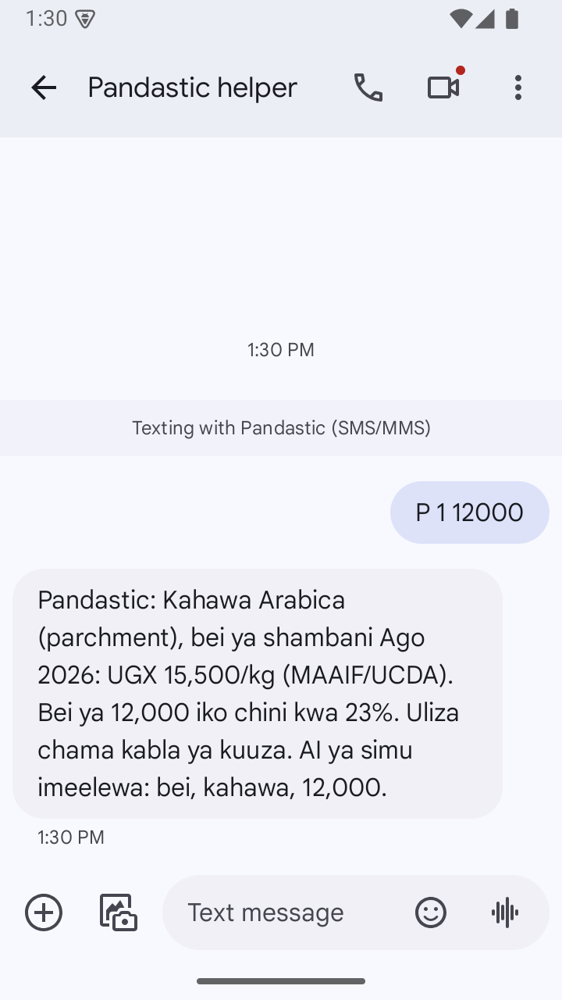 | 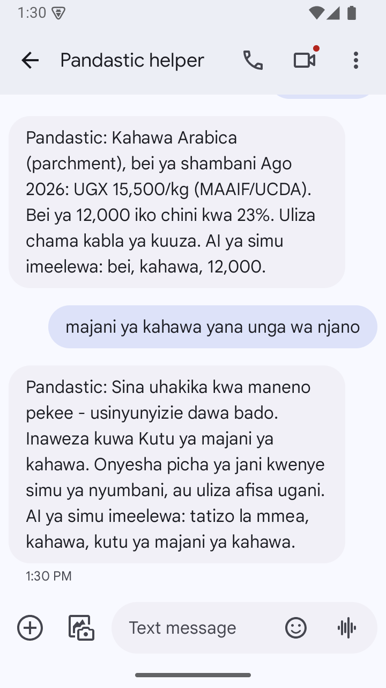 | 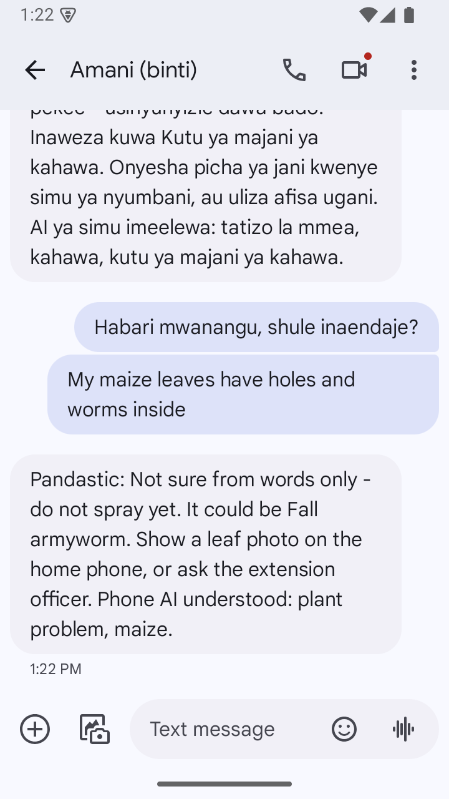 | 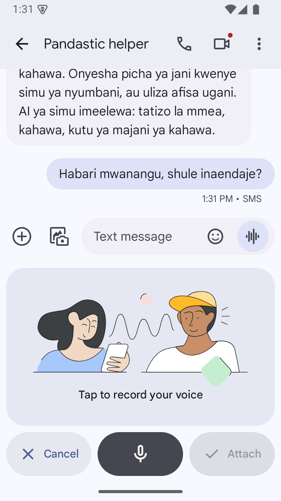 |
| **Photo: coffee leaf rust** | **Photo: not sure** | **Photo: blurry** | **Photo: not a leaf** |
| 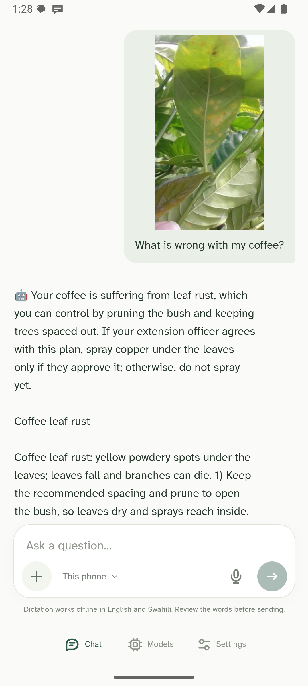 | 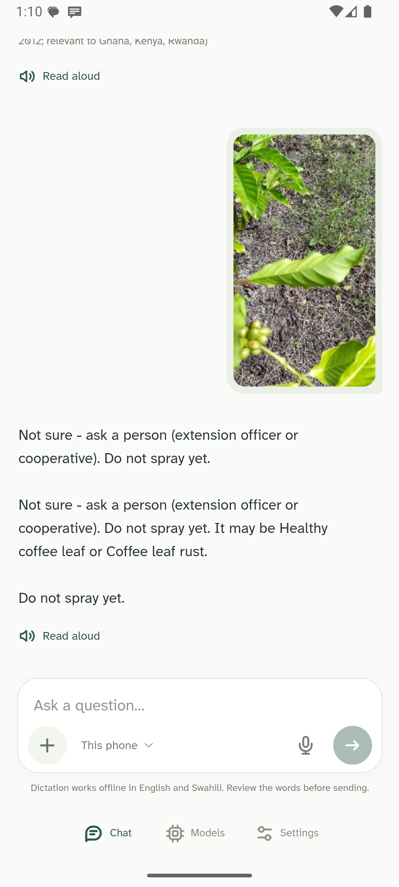 | 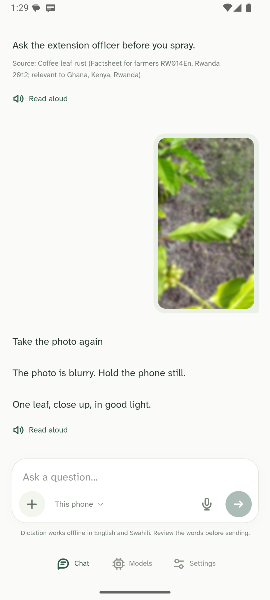 | 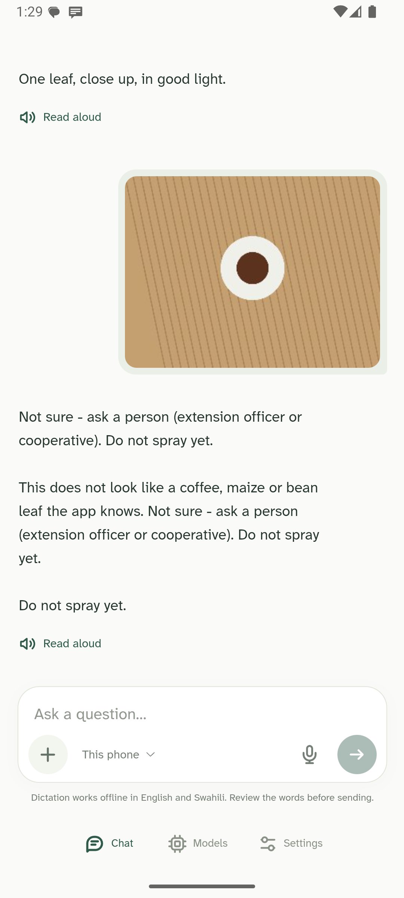 |
| **Phone mode** | **Price in chat** | **SMS helper settings** | **Models** |
| 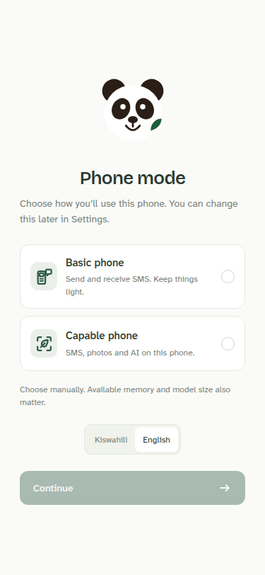 | 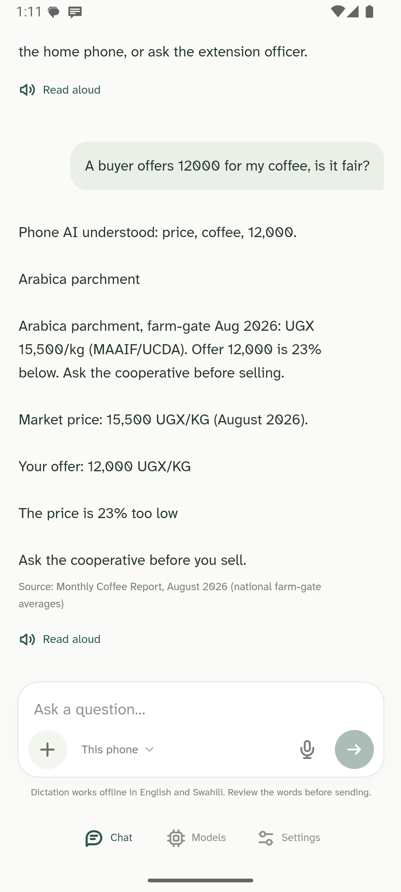 | 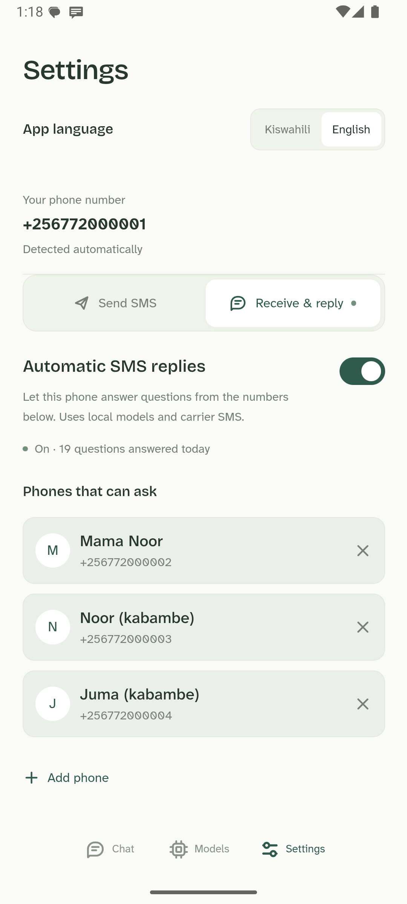 | 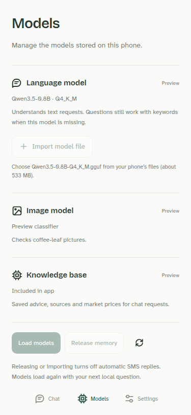 |

## How it works

### Two phone modes

On first launch, the owner chooses **Basic phone** or **Capable phone** (Android shows the phone's total RAM; the
choice can be changed in Settings).

- **Basic phone:** a clean SMS conversation and Settings. It sends and receives SMS through the SIM without loading
  any model. A phone without the app can use its ordinary SMS app instead.
- **Capable phone (the helper):** the same chat, plus **This phone** for local questions, camera and gallery
  attachments, a **Models** page, and optional **automatic SMS replies** to the contacts the owner allows.

### Local processing

```text
 Noor's basic phone ──SMS──► SmsReceiver ─► HubService (allowlist, rate limit, store-and-forward log)
                                              │
 Daughter's phone UI (React in WebView) ──────┤  NativeBridge
   photo ─► QualityGate ─► LeafClassifier (ONNX) ─┐
   text / SMS ─► KeywordNlu + Qwen3.5-0.8B (llama.cpp, GBNF; fills what keywords miss)┐
                                                   ▼                                  ▼
                               Resolver (thresholds and statuses in code) ◄── knowledge.sqlite
                                                   │                      (cited advice, prices, lexicon)
                                                   ▼
                               Decision ─► reply in chat  /  ≤ 2-part SMS (safety line first)
```

| Part | What | Size |
| :-- | :-- | :-- |
| Leaf classifier | 3 × EfficientNet-B0 averaged in one ONNX file (int8 weights), 14 labels: coffee, maize and bean leaf problems, healthy leaves, and "not a leaf". Temperature-calibrated, with per-label minimum probabilities chosen on calibration photos run through the app. A plant-share and blur gate runs first. | 13 MB, in the APK |
| Language model | Qwen3.5-0.8B Q4_K_M (Apache-2.0, multilingual), fine-tuned with LoRA on farmer SMS, run by llama.cpp under a GBNF grammar. It reads every message; its reading is used only where the keywords found nothing. In the helper's chat it may also reword the fixed answer (checked word by word in code). It never writes advice. | 542 MB, optional: downloaded once in the app (opt-in) or imported from a file |
| Knowledge base | SQLite: cited advice (English + Swahili), UCDA/MAAIF coffee farm-gate prices, WFP maize and bean prices, Swahili/English lexicon | 360 KB, in the APK |
| Dictation | Whisper Tiny multilingual (Q5_1) through whisper.cpp, English and Swahili, offline | 32 MB, in the APK |
| App | Java + React (bundled, offline). The INTERNET permission is used for one thing, the opt-in model download; questions, photos and answers never go online, and the WebView blocks every network load. | ~90 MB arm64 release APK |

Peak memory with the language model loaded is under 1 GB (the model file is memory-mapped), on a 4 GB target phone.

## Guardrails

- **A fixed list of answers.** Every fact the farmer reads comes from a template or a cited advice row. Models
  choose labels and slots, and code checks them. In the helper's chat, the on-phone model may reword the answer for
  the person reading it (`ReplyWriter`), and code rejects any rewrite that adds a number, crop, disease, chemical,
  unit, organisation or "healthy" claim, drops a warning ("not sure", "don't spray yet", "ask the officer") or a
  price's UGX figure and source, or, in Swahili, uses a word that is not in the answer. The fixed answer is always
  shown under the model's words, and **automatic SMS always get the fixed answer**.
- **"Not sure — ask a person."** A blurry photo, a low-confidence result or an unknown object leads to "ask a
  person, don't spray yet". Text alone is never treated as a diagnosis. Old prices are flagged as old.
- **The person decides.** The owner explicitly opts in to automatic SMS replies, and chat keeps every instruction
  to ask an officer.
- **The language model never decides alone.** The base model invented symptoms for vague text during testing, so
  the model may add a symptom only if it is the fine-tuned file, the SMS reports a problem, the keywords found the
  crop, and the label is a real problem (never "healthy"). Crop, price and language always come from keywords.
- **Airtime and privacy.** Only numbers the owner lists get answers, short codes are ignored, personal SMS are left
  alone, replies are rate-limited, and messages stay on the phone and can be cleared.

## Results

**Leaf photos**, held-out test photos sent through the real app on an emulator (share answered / right when it
answers / sick leaf called healthy):

| Test photos | Result |
| :-- | :-- |
| Coffee, RoCoLe phone photos of leaves on the plant (360) | 65.0% / 97.4% / 0 |
| Maize, CCMT Ghana (336) | 79.2% / 90.6% / 0 |
| Beans, iBean Uganda (129) | 100% / 96.1% / 1 |
| Non-crop photos: everyday scenes and objects (137) | 1 answered |

**Reading SMS** (all slots right; `fresh2` is 30 synthetic SMS never used to tune anything):

| | held-out (50) | fresh2 (30) |
| :-- | --: | --: |
| Keywords alone | 76% | 83% |
| Base Qwen3.5-0.8B alone | 34% | 27% |
| **Keywords + fine-tuned Qwen (the app)** | **98%** | **93%** |

24 of the 50 held-out SMS have a near-copy among the fine-tune's training SMS, so `fresh2` is the number to trust.
Reports: `ml/reports/` (`nlu_eval_lora.json`, the leaf model's `metrics.json` and `app_check_*.csv`).

**Writing replies.** We measured whether a phone-sized model can write the reply itself (Qwen3.5-0.8B base and
fine-tuned, Qwen3.5-2B, Gemma 3 1B; Swahili, English, Spanish, Indonesian, Vietnamese). In Swahili, none can: they
write non-words or copy. In every language they sometimes reverse the meaning in fluent sentences ("that's a fair
price" for an offer 23% below, "copper is not needed"). That is why code checks every rewrite and automatic SMS
never use one.

## Run it

### Quickest: Docker (two phones in the browser, real models)

Only Docker (with Compose v2) is needed:

```sh
docker compose up --build      # the first run downloads the 542 MB language model and builds llama.cpp
```

Open <http://localhost:8080>: Noor's basic phone on the left, the helper phone on the right (each also on its own at
<http://localhost:5173> and <http://localhost:5174>; a phone's number is its port). Send `P 1 12000` or a leaf
problem in your own words ("majani ya kahawa yana unga wa njano chini") from the basic phone; the helper reads it
with the fine-tuned Qwen and answers by simulated SMS. Its chat stays clear; the helper log in Settings shows the
exchange. On the helper phone, **+** checks a leaf photo.

The answers come from the helper phone's own Java code (`Brain`, keyword + Qwen NLU, `Resolver`, `ReplyWriter`,
`HubPolicy`, the ONNX leaf classifier and quality gate), compiled unchanged from `android/` for a normal JVM
(`desktop/`), with llama.cpp built for Linux. The fine-tuned model is checked against the size and SHA-256 in
`ml/llm/model.json`. The brain uses about 800 MB of memory and, on x86_64, a CPU with AVX2.

Two demo settings in `docker-compose.yml` differ from the app: every SMS gets an answer (non-farming ones get the
menu; the app leaves personal messages unanswered, `PANDASTIC_HUB_ANSWER_ALL: "0"`), and the hourly reply limit is
raised (`PANDASTIC_HUB_HOURLY_LIMIT`). Dictation runs on-device only in the Android app.

```sh
docker compose up -d --build   # in the background; docker compose logs -f brain shows the model reading each SMS
docker compose down -v         # stop and clear both phones' chats
```

**On a server** (Docker, 2 GB RAM, 5 GB disk, x86_64 with AVX2; open TCP ports 8080, 5173 and 5174):

```sh
git clone https://github.com/mpelossi/pandastic && cd pandastic
PANDASTIC_PUBLIC_HOST=<server IP or domain> docker compose up -d --build
```

`PANDASTIC_PUBLIC_HOST` must match the address in the browser exactly. Everyone who opens the page shares the same
two phones. It is plain HTTP, so browsers block the microphone; typing, SMS and gallery photos work. The phones run
the Vite development server: fine for a demo, not for anything private.

**Build the APK in a container:**

```sh
docker build --target apk --output out .                                                   # out/app-debug.apk
docker build --target apk --build-arg GRADLE_ARGS="-PphoneOnly assembleRelease" --output out .   # arm64 release
```

The container signs with its own debug key; if a locally built copy is installed, `adb uninstall org.pandastic.relay`
first (this also deletes the app's data, including an imported model).

### Android app and emulators

Requirements: JDK 17, Android SDK 35, NDK `28.2.13676358` with CMake 3.22.1 (for llama.cpp and whisper.cpp), Node
20+ and **Corepack** (Gradle runs the pnpm version pinned in `frontend/package.json`) or, on Node 25+, a global
**pnpm**.

```sh
make run            # start/select an emulator, build, install and launch (plain make does the same)
make run-device     # the same on a USB-connected phone
make release        # ~90 MB arm64 APK for side-loading
./run.sh            # two emulator phones (helper + basic) with the real APK and a simulated SMS carrier
./run.sh --web      # two browser phones on 5173/5174 without Docker (Node 22.13+; labelled demo answers, no models)
make web            # UI only, in a desktop browser (labelled demo answers)
make stop           # shut down the running emulator
```

With several AVDs or emulators, select one with `EMULATOR_NAME=Your_AVD` or `DEVICE=emulator-5554`. Startup logs are
in `/tmp/pandastic-emulator.log`. The first build downloads pnpm, dependencies, llama.cpp, whisper.cpp and the
Whisper model; the installed app runs offline. Without the NDK, `cd android && ./gradlew -Pnollm assembleDebug`
builds an app that uses keyword understanding only.

`./run.sh` installs Qwen on the helper emulator (a local fine-tuned GGUF under `ml/artifacts` if present, otherwise
the base model, SHA-256 checked); `SKIP_QWEN=1` skips it and `./run.sh --help` lists the options. The emulators
cannot pass SMS to each other, so `scripts/sms-lab.mjs` acts as the carrier: type `P 1 12000` in the basic phone's
chat. A single emulator also takes `adb emu sms send 0700000001 "P 1 12000"`.

### Two real phones

1. Install the APK on both. On the helper phone, choose **Capable phone**, download the language model on the
   **Models** page (opt-in, ~542 MB, checked by size and SHA-256), or import the `.gguf` file from the
   [`models-v1` release](https://github.com/Casa-del-dev/Pandastic-4/releases/tag/models-v1).
2. In **Settings → Automatic SMS replies**, pick Noor's number from Contacts, turn the switch on, and allow SMS,
   notifications and "ignore battery optimisation".
3. On Noor's phone, choose **Basic phone** and pick the helper as the SMS destination, or just use any SMS app.
4. Text `P 1 12000`. A personal message ("Habari mwanangu, shule inaendaje?") gets no automatic reply.

Both phones need SIMs with SMS credit; mobile data and Wi-Fi are not needed. The debug build also accepts the model
from adb:

```sh
adb push Qwen3.5-0.8B-pandastic-Q4_K_M.gguf /data/local/tmp/
adb shell run-as org.pandastic.relay mkdir -p files/models
adb shell run-as org.pandastic.relay cp /data/local/tmp/Qwen3.5-0.8B-pandastic-Q4_K_M.gguf files/models/
```

An optional `Qwen3.5-2B-Q4_K_M.gguf` (1.28 GB) placed in the same folder writes the helper's English chat replies;
SMS are still read by the fine-tuned 0.8B.

### Tests

```sh
cd android && ./gradlew testDebugUnitTest   # resolver, keywords, NLU policy, SMS formatting, number matching
cd frontend && corepack pnpm test:local     # browser phone pair over real HTTP
make sms-test                               # with ./run.sh running: SMS end to end on two emulators
make e2e DEVICE=emulator-5554               # every UI <-> native call inside the running app
node scripts/photo-eval.mjs photos.csv      # labelled leaf photos (path,label) through the app on an emulator
```

### Training (Modal)

Models are trained on [Modal](https://modal.com) (`modal token new` once):

```sh
python ml/fetch_prices.py                                 # refresh prices from the official sources (data/*.csv)
python ml/build_knowledge.py                              # rebuild and validate knowledge.sqlite from data/
cd ml
modal run --detach modal_app.py --stage all --labels p2   # leaf classifier: fetch -> manifest -> train -> calibrate
modal run modal_lora.py                                   # Qwen3.5-0.8B LoRA -> GGUF Q4_K_M -> held-out eval
```

Python packages: `numpy onnx onnxruntime pillow pandas requests pypdf imagehash timm modal torch torchvision`.
`python -m leaf.install artifacts/<version>` (from `ml/`) installs a trained leaf model into the app's assets.

## Repository

```text
android/app/src/main/java/org/pandastic/relay/
  FrontendActivity.java, NativeBridge.java   React host + JS bridge (window.PandasticNative)
  BrainHost.java                             one model thread shared by the UI and the SMS hub
  hub/                                       SMS receiver, foreground service, allowlist, log, sender
  brain/                                     classifier, quality gate, resolver, NLU (keywords + Qwen), SMS formatter
android/app/src/main/cpp/                    llama.cpp and whisper.cpp JNI (sources fetched at build time)
frontend/                                    React UI (Swahili first), bundled into the APK; local/ = browser phone pair
desktop/                                     the app's Java brain on a desktop JVM for Docker (Android shims, JNI build)
ml/                                          Modal training, knowledge-base builder, NLU and photo evaluation, reports
data/                                        price, advice and lexicon sources for knowledge.sqlite
scripts/                                     emulator launcher, SMS lab, end-to-end tests, model install
Dockerfile, docker-compose.yml               browser demo with the real models, APK build, deployment
```

## Data and licences

Every advice and price row carries a `source_id`, and the knowledge-base build fails if one is missing. Swahili
advice is machine-translated by the team and marked as such.

**In the app (`knowledge.sqlite`):**

| Data | Source | Licence |
| :-- | :-- | :-- |
| Coffee farm-gate prices, national monthly averages, Dec 2024 – Aug 2026 | [MAAIF Coffee Department / UCDA monthly reports](https://ugandacoffee.go.ug/resource-center/reports/monthly-reports) | Uganda government publication |
| Maize and dry bean retail prices by market, Jan 2024 – Aug 2026 | [WFP food prices for Uganda, via HDX](https://data.humdata.org/dataset/wfp-food-prices-for-uganda) | CC BY-IGO |
| Coffee leaf rust, maize grey leaf spot, maize streak virus advice | CABI Plantwise factsheets [RW014](https://plantwiseplusknowledgebank.org/doi/10.1079/PWKB.20127801774), [ZM013](https://plantwiseplusknowledgebank.org/doi/full/10.1079/pwkb.20147801404), [KE015](https://factsheetadmin.plantwise.org/Uploads/PDFs/20117800551.pdf) | CC BY-SA 4.0 (paraphrased, cited) |
| Brown eye spot, fall armyworm, northern leaf blight, bean rust, angular leaf spot advice | [Pacific Pests, Pathogens & Weeds fact sheets](https://apps.lucidcentral.org/ppp/) (ACIAR / SPC) | Free online fact sheets (paraphrased, cited) |
| Coffee leaf miner advice | [Dantas et al., *Insects* 12(12):1130, 2021](https://doi.org/10.3390/insects12121130) | CC BY 4.0 |
| Phoma leaf spot advice | [Pereira & Reis, Revista Cultivar, 2024](https://revistacultivar.com/articles/phoma-spot-or-ascochyta-spot-of-coffee) | Publisher copyright (paraphrased, cited) |
| Swahili/English keywords and menu codes | Written by the team | MIT (this repository) |

**Leaf classifier training data:** [BRACOL](https://data.mendeley.com/datasets/yy2k5y8mxg/1) (Brazil),
[JMuBEN](https://data.mendeley.com/datasets/t2r6rszp5c/1) + [JMuBEN2](https://data.mendeley.com/datasets/tgv3zb82nd/1)
(Kenya), [RoCoLe](https://data.mendeley.com/datasets/c5yvn32dzg/2) (Ecuador),
[CCMT](https://data.mendeley.com/datasets/bwh3zbpkpv/1) (Ghana, maize),
[PlantDoc](https://github.com/pratikkayal/PlantDoc-Dataset) and
[Caltech-101](https://data.caltech.edu/records/mzrjq-6wc02), all CC BY 4.0;
[iBean](https://huggingface.co/datasets/AI-Lab-Makerere/beans) (Makerere AI Lab, Uganda), MIT; ImageNet weights
from timm `efficientnet_b0.ra_in1k`, Apache-2.0. The datasets are downloaded by `ml/` and are not in this
repository.

**SMS data:** all synthetic, written or generated by the team (`ml/llm/eval_sms*.csv`, `ml/llm/gen_train.py`). No
real farmer messages were used.

**Why it matters:** one extension worker serves ~1,800 farmers in Uganda against a recommended 1:500
([UFAAS, 2023](https://ufaas-ugandacf.org/wp-content/uploads/2023/12/Policy-Brief-on-Re-energising-AEAS-in-Uganda-FINAL.pdf));
~1.8 million households grow coffee and 23% are in cooperatives
([ILO, 2024](https://www.ilo.org/sites/default/files/2024-07/Uganda_Coffee_Value_Chain_Mapping.pdf)); the Arabica
farm-gate price moved 25% in 21 months (MAAIF/UCDA); and women in sub-Saharan Africa are 22% less likely to own a
smartphone than men ([GSMA, 2025](https://www.gsma.com/gender-gap-2025/)).

## Limits we state openly

- **Photos:** coffee, maize and bean leaves only; no berries, so no coffee berry disease. There are no Ugandan
  coffee leaf photos, and coffee photos from one country transfer poorly to another (a model never trained on
  RoCoLe answered 1.2% of its photos). Maize and bean results are measured on held-out photos from the same source.
  When unsure, the app says so and asks for a person.
- **Advice:** 13 conditions, from Rwandan, Zambian, Kenyan, Pacific and Brazilian sources, not Ugandan extension
  material. It never gives pesticide doses and always says "ask the officer before spraying".
- **Swahili:** machine-translated and needs review by native speakers. Luganda has only crop words; replies to it
  are the safe "not sure" answer.
- **Prices:** national averages, not Noor's own market. WFP maize and bean prices are retail, and since mid-2026
  come only from refugee-settlement markets, so older highland prices are flagged as old.
- **Allowlist:** it controls cost; it is not authentication, because caller ID can be spoofed.
- **Language model:** a one-time 542 MB download over mobile data (opt-in), or a file copied to the phone.
  Everything works without it.
- **Not yet tested:** a real 4 GB phone, real carrier SMS delays, the helper surviving a night of Android battery
  saving, and the app on a 0.5 GB phone.

## License

The code in this repository is released under the [MIT License](LICENSE).

Third-party data, models and runtimes keep their own licences: the data sources listed above; Qwen3.5-0.8B
(Apache-2.0); llama.cpp, whisper.cpp and the Whisper model (MIT, see
`android/app/src/main/speech-NOTICE.txt`); ONNX Runtime (MIT). The fine-tuned leaf classifier and language model
are derived from the datasets and base models above.
